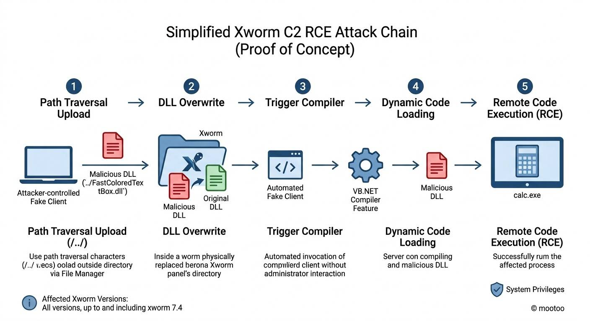

# XWorm C2 Controller - 0-Day Remote Code Execution (RCE)

[](https://github.com/mootoo11)
[](LICENSE)
[](https://python.org)
[](#vulnerability-summary)
[](#affected-software)

---

## 📌 Overview

This repository contains the **Proof of Concept (PoC)** and technical breakdown for a **0-day pre-authentication Remote Code Execution (RCE)** vulnerability affecting the **XWorm RAT C2 Control Panel**.

By abusing an unauthenticated path traversal vulnerability in the panel's file reception logic, an attacker acting as a fake client can overwrite internal panel dependencies (`FastColoredTextBox.dll`). Subsequently, issuing a protocol command triggers dynamic loading of the overwritten assembly, executing arbitrary code within the context of the running C2 panel (typically with administrative privileges).

- **Discovered & Researched by:** [mootoo](https://github.com/mootoo11)
- **Profile:** [https://github.com/mootoo11](https://github.com/mootoo11)

---

## 🔍 Vulnerability Summary

| Parameter | Details |
|---|---|
| **Target Application** | XWorm Remote Access Trojan (RAT) Controller / Panel |
| **Affected Versions** | All versions up to and including **XWorm v7.4** |
| **Vulnerability Type** | Path Traversal File Overwrite + DLL Hijacking / Dynamic Loading $\rightarrow$ RCE |
| **CWE Classification** | [CWE-23: Relative Path Traversal](https://cwe.mitre.org/data/definitions/23.html) <br> [CWE-427: Uncontrolled Search Path Element](https://cwe.mitre.org/data/definitions/427.html) |
| **Required Privileges** | None (Pre-Authentication / Client Protocol Emulation) |
| **Impact** | Full Remote Code Execution (RCE) on the C2 Server Host |

---

## ⚡ Attack Chain Breakdown



The attack chain consists of five automated stages:

```
[Fake Client]
      │
      ├─ 1. Path Traversal Upload (../FastColoredTextBox.dll)
      ▼
[XWorm Panel Directory]
      │
      ├─ 2. Overwrites FastColoredTextBox.dll
      ▼
[Trigger Protocol Command]
      │
      ├─ 3. Fake Client sends "Compiler" Command
      ▼
[Dynamic Code Loading]
      │
      ├─ 4. Panel opens VB.Net Compiler & loads FastColoredTextBox.dll
      ▼
[Remote Code Execution (RCE)]
      └─ 5. Arbitrary Code Executed (calc.exe / Shell / System Privileges)
```

### Detailed Steps:

1. **Protocol Handshake & Fake Registration**:
   - The exploit emulates an infected client connecting to the XWorm C2 listening port (default: `1723`).
   - Using the panel's default encryption configuration (AES-128-ECB derived from the MD5 of the key), the script sends an `INFO` handshake containing crafted victim metadata.
   - The panel registers the fake client as active.

2. **Path Traversal via File Manager**:
   - The exploit opens a virtual file management session (`FileM`) specifying a directory traversal path (`..`).
   - It issues a `downloadedfile` packet providing the target path `..` and filename `FastColoredTextBox.dll`.
   - The C2 server fails to validate or sanitize the target path against directory traversal, writing the file directly into the root directory of the XWorm controller application instead of the isolated client storage folder.

3. **Dependency Overwriting**:
   - The uploaded payload overwrites `FastColoredTextBox.dll`, a .NET syntax highlighting library commonly loaded on-demand by the XWorm GUI.

4. **Automated Triggering without User Interaction**:
   - After allowing disk I/O to complete, the fake client sends the `Compiler` protocol command.
   - The controller UI invokes the VB.NET Compiler sub-window without requiring any manual interaction from the operator.

5. **Assembly Load & Code Execution (RCE)**:
   - When the panel launches the compiler interface, the .NET CLR loads the newly written `FastColoredTextBox.dll`.
   - The static constructor / entry point inside the malicious DLL executes arbitrary code in the context of the user running the controller (often `Administrator`).

---

## 📂 Repository Contents

```
├── exploit.py               # Automated Python PoC exploit script
├── FastColoredTextBox.dll   # Weaponized proof-of-concept DLL (executes calc.exe)
├── poc.jpg                  # High-resolution Attack Chain infographic
├── poc.mp4                  # Full video demonstration of the exploit in action
├── requirements.txt         # Python dependencies
├── LICENSE                  # MIT License
└── README.md                # Technical documentation and analysis
```

---

## 🚀 Usage & Reproduction

### Prerequisites

- Python 3.8+
- Install dependencies:
  ```bash
  pip install -r requirements.txt
  ```

### Running the Exploit

```bash
python exploit.py -up FastColoredTextBox.dll -H <C2_HOST> -p <C2_PORT> -k "<ENCRYPTION_KEY>"
```

#### Arguments:
- `-up`, `--upload`: Path to the DLL payload to upload (default: `FastColoredTextBox.dll`).
- `-H`, `--host`: IP or hostname of the XWorm panel (e.g. `127.0.0.1` or target lab server).
- `-p`, `--port`: Port of the XWorm panel (default: `1723`).
- `-k`, `--key`: XWorm communication key (default: `<V74PV74PV74PV74P>`).
- `-d`, `--dir`: Directory traversal sequence (default: `..`).
- `-t`, `--trigger-name`: Identifier for the compiler window trigger.

---

## 🎥 Video Demonstration

A complete end-to-end video demonstration is included in this repository: [poc.mp4](poc.mp4).

---

## 🛡️ Remediation & Defensive Recommendations

For threat intelligence teams and defenders analyzing or neutralizing malicious XWorm infrastructures:

1. **Path Sanitization**: Ensure any path received over network streams is resolved via `Path.GetFullPath()` and strictly verified to stay within an isolated `downloads` directory. Disallow `..`, absolute paths, and UNC paths.
2. **Integrity Verification**: Enforce strong assembly signing and integrity checks prior to dynamically loading external libraries.
3. **Authentication**: Implement robust cryptographic mutual authentication rather than relying on static or easily reversed pre-shared keys.

---

## 📜 Disclaimer

This proof of concept is published strictly for **educational, defensive, and authorized security research purposes**. The author does not endorse or take responsibility for any unauthorized or illicit activities conducted with this code.

---

## 👤 Author & Credits

- **Researcher:** mootoo
- **GitHub:** [@mootoo11](https://github.com/mootoo11)
